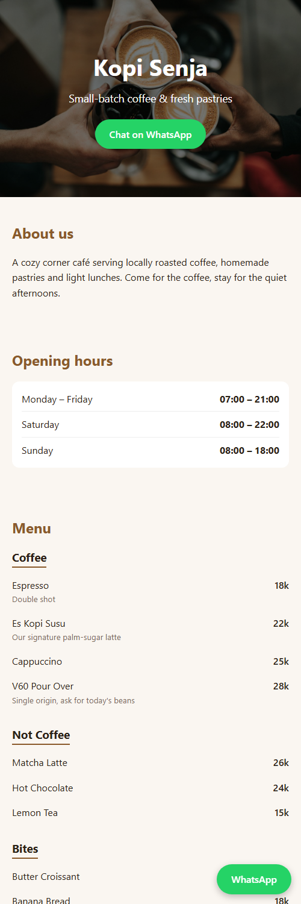

# Café Site Template

A one-page website template for local shops and cafés. Plain HTML/CSS/JS, no build step, free to host.

**Live demo:** https://rasbinus.github.io/cafe-site-template/

The demo uses a fictional café ("Kopi Senja"), not a real business.

## Features

- Mobile-first, single `index.html` file
- Business name, tagline, logo or hero photo
- WhatsApp button (wa.me link with your number and a prefilled message), plus a floating button on mobile
- Opening hours
- Editable menu with categories, prices and notes
- Address, "Open in Google Maps" button and an optional embedded map
- Easy retheming through a few CSS color variables

## Customize for a client

Open `index.html` and edit the `CONFIG` block at the top. You don't need to touch anything below it.

| Field | What to put |
| --- | --- |
| `name`, `tagline`, `description` | The shop's text |
| `heroImage`, `logo` | Image URL or file path (e.g. `images/hero.jpg`). Use `""` to skip |
| `whatsapp.number` | International format, digits only (`6281234567890`) |
| `whatsapp.message` | Prefilled chat message |
| `address`, `mapsLink` | Address text and a Google Maps share link |
| `mapsEmbed` | Optional: the `src` URL from Maps > Share > Embed a map. `""` to hide |
| `hours` | One `["Day", "Time"]` row per line |
| `menu` | Categories, each with a list of `{ name, price, note }` items |

To change colors, edit the `:root` variables in the `<style>` block.

## Hosting

Any static host works. For GitHub Pages: Settings > Pages > deploy from the `main` branch, root folder.

## License

Free to use and adapt.
